# Canadian-ness LLM evaluations

Evaluate **already-generated answers** with **gpt-oss-120b on icelab**, using DeepEval **4.3.2**. Retain each metric score, judge explanation, reference evidence and checkpoint. The evaluator never regenerates tested-model answers.

> **Run judging on a normal desktop, not HPC.** In this project's environment HPC cannot reach the icelab judge. Generate answers on HPC, transfer the answered benchmark, and clone/copy this repository onto a desktop with approved icelab network access.

```mermaid
flowchart LR
    A[Benchmark questions] --> B[HPC: generate answers]
    B --> C[Transfer Excel or JSONL to desktop]
    C --> D[Validate answers and metric assignments]
    D --> E[Lock configuration and record authorization]
    E --> F[Desktop: DeepEval + icelab judge]
    F --> G[Checkpoint each score and explanation]
    G --> H[Excel, CSV, JSONL and comparisons]
    G -. resume missing or failed tasks .-> F
```



Without Mermaid: **HPC answers → desktop validation → authorized judging → checkpoints → reports.** References/context are judge evidence, not automatically the tested model's input.

## Completed experiments

Start at **[Results index](results/README.md)**. All results are **AI-provisional, pending calibration**.

| Experiment | Data condition | Models | Judgments |
|---|---|---|---:|
| [1. Original outputs](results/01_original_outputs/README.md) | User-labelled temperature 0 | Llama, GC LLM, Apertus | 5,442 |
| [2. Temperature-0.7 workbook](results/02_temperature_07_workbook/README.md) | Mixed-temperature workbook | Same three | 5,442 |
| [3. Repetition-cleaned](results/03_repetition_cleaned/README.md) | Supplied edited answers, M1–M7 | Same three | 5,442 |
| [4. Correctness + completeness](results/04_correctness_completeness/README.md) | Same cleaned answers, two additional metrics | Same three | 4,536 |

Each page links to Excel, every score/explanation, answered datasets and manifests. Temperature/checkpoint metadata is incomplete; GC LLM's workbook has **one reused temperature-0 answer**. See [interpretation limits](docs/experiment_interpretation.md).

Outputs are ignored by Git by default. A source-only clone may need the separately shared authorized data/results bundle; preserve its folder paths when copying it into the desktop checkout.

For the first commit/push and HPC checkout, see [Git and secret protection](docs/git_and_secrets.md).

## Desktop setup — PowerShell

Open a terminal in the repository. Python **3.13** matches the recorded research environment.

For a fresh desktop checkout, replace `YOUR_REPOSITORY_URL` with the project's actual URL, run `git clone "YOUR_REPOSITORY_URL" LLMEvals`, then `Set-Location LLMEvals`. Alternatively copy the project directory using your approved transfer method; exclude another user's `.env` and `.venv`.

```powershell
py -3.13 -m venv .venv
.\.venv\Scripts\python.exe -m pip install -r requirements-lock.txt
.\.venv\Scripts\python.exe -m pip install --no-deps -e .
if (!(Test-Path .env)) { Copy-Item .env.example .env }
notepad .env
```

Set `LLM_KEY` to your authorized icelab credential and `LLM_MODEL=gpt-oss-120b`. Keep the supplied HTTPS endpoint and 180-second timeout. Never commit `.env` or share it with results.

```powershell
.\.venv\Scripts\python.exe -m canadianness_eval.cli check-connection
.\.venv\Scripts\python.exe -m canadianness_eval.cli validate-metrics
```

The connection check makes live requests. A desktop still needs the required network permissions. TLS stays enabled. Recorded judge temperature/top_p are omitted; their server defaults are not established.

## Run another answered benchmark

Follow **[the complete run guide](docs/run_answered_benchmark.md)**: import → validate → approval → pilot → full run → resume → export.

Example conversion of one answer column, preserving the original source:

```powershell
.\.venv\Scripts\python.exe scripts\prepare_answered_dataset.py `
  --input data\incoming\my_benchmark\answered.jsonl `
  --output data\processed\my_benchmark_v1\cases.jsonl `
  --answer-column model_answer --model-variant my_model `
  --provenance "Actual model checkpoint, generation source and evidence provenance"
.\.venv\Scripts\python.exe -m canadianness_eval.cli validate-dataset `
  --input data\processed\my_benchmark_v1\cases.jsonl
```

**Choose the right protocol.** Recorded full research runners are locked to the 756-question CORE benchmark. Generic `cli evaluate` supports new datasets but requires a genuinely human-approved frozen configuration; none is bundled as approved. That legacy generic protocol differs from the recorded v2 protocol. The guide explains both paths and their approval boundaries.

## Folder map

| Folder | Purpose |
|---|---|
| [results/](results/README.md) | Four experiment entry points and summary tables |
| [data/](data/README.md) | Answer-free benchmark view, original answered files, prepared inputs |
| [config/](config/README.md) | Exact rubrics, fixed interpretation, manifests and permissions |
| [outputs/](outputs/README.md) | Canonical workbooks, scores/reasons, checkpoints and comparisons |
| [src/](src/README.md) | Evaluator, gateway, ingestion and checkpoint implementation |
| [scripts/](scripts/README.md) | Conversion, analysis, packaging and maintenance |
| [docs/](docs/README.md) | Run guide, methodology and historical provenance |
| tests/ | Offline tests; live tests require explicit opt-in |

Some supplied root files must retain their exact paths for frozen manifests/code. The [organization record](docs/repository_organization/README.md) explains why those are preserved.

## Monitor and troubleshoot

```powershell
# Read-only counts: no judge requests.
.\.venv\Scripts\python.exe -m canadianness_eval.general_quality_run status
# Offline checks; do not enable live-test opt-in.
.\.venv\Scripts\python.exe -m pytest -q -m "not integration"
```

- **401/403:** check credentials and desktop access; never substitute an unrelated judge.
- **429/timeouts:** bounded retries are built in; resume with the same authorized command and configuration.
- **Checksum mismatch:** stop and investigate; do not edit manifests to bypass validation.
- **Interrupted:** preserve original inputs, manifests, `records/` and `raw/`; successful checkpoints are reused.

Failed/unscored tasks are not zeros. Scores are normalized once to 0–1. No arbitrary overall Canadian-ness score, scientific validation or team calibration is implied.
